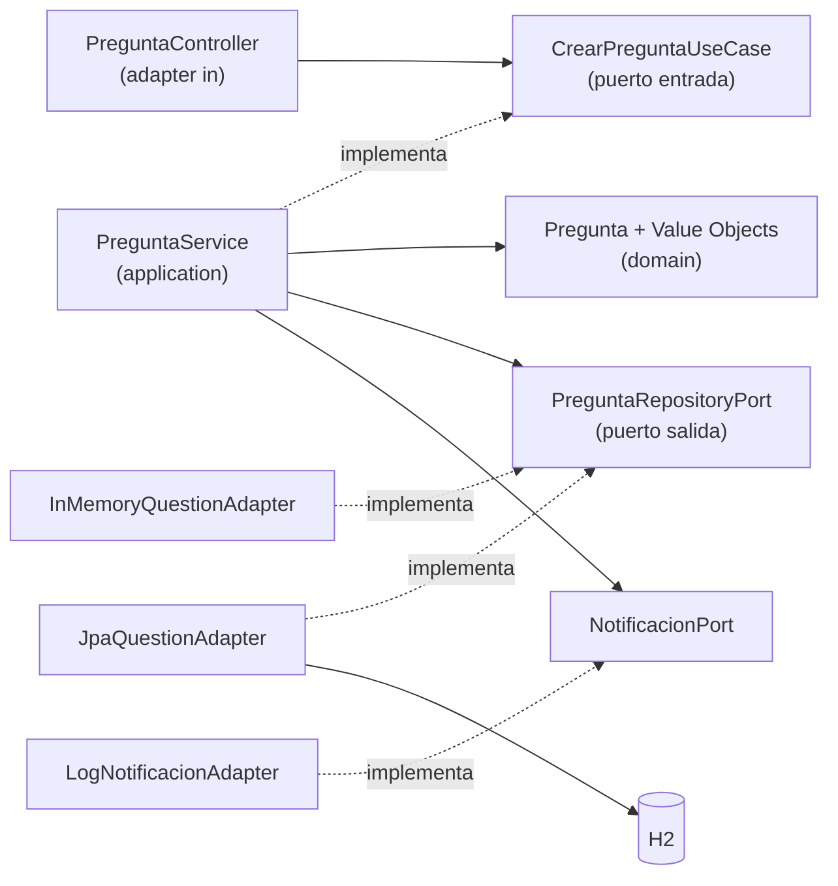

# Banco de Preguntas Saber PRO — Taller 12 (DDD + Arquitectura Hexagonal, Fase I)

Java 17 · Spring Boot 3.4.5 · Spring Data JPA · H2 · JUnit 5

## Estructura

```
src/main/java/co/edu/unicauca/bancosaberpro/
├── domain/                      # Java puro (sin Spring/JPA)
│   ├── model/                   # Pregunta (Aggregate Root), PreguntaId, EstadoPregunta
│   ├── valueobject/             # Enunciado, Justificacion, OpcionRespuesta (records inmutables)
│   ├── exception/               # ReglaNegocioException, PreguntaNoEncontradaException
│   └── ports/
│       ├── inbound/             # CrearPreguntaUseCase (+ comando)
│       └── outbound/            # PreguntaRepositoryPort, NotificacionPort
├── application/service/         # PreguntaService (implementa el puerto de entrada)
└── infrastructure/
    ├── adapter/in/web/          # PreguntaController (REST) + DTOs + manejo de errores
    ├── adapter/out/persistence/ # JpaQuestionAdapter + entidad JPA + Spring Data
    ├── adapter/out/memory/      # InMemoryQuestionAdapter (mapa en memoria)
    ├── adapter/out/notification/# LogNotificacionAdapter
    └── config/                  # HexagonalConfiguration (seleccion de adaptador por perfil)
```

## Diagrama



## Ejecutar

```bash
# Paso 1: adaptador JPA (por defecto)
mvn spring-boot:run

# Paso 2: adaptador en memoria (solo cambia el perfil)
mvn spring-boot:run -Dspring-boot.run.profiles=memory

# Paso 3: pruebas (unitarias + integracion con ambos adaptadores)
mvn test
```

## Endpoints

```bash
curl -X POST localhost:8080/api/preguntas -H "Content-Type: application/json" -d '{
  "enunciado": "¿Que patron desacopla el nucleo de la infraestructura?",
  "justificacion": "Los puertos y adaptadores invierten la dependencia hacia el dominio.",
  "opciones": [
    {"texto":"MVC","esCorrecta":false},
    {"texto":"Hexagonal","esCorrecta":true},
    {"texto":"Singleton","esCorrecta":false},
    {"texto":"Observer","esCorrecta":false}]}'

curl -X POST localhost:8080/api/preguntas/{id}/enviar-revision
curl localhost:8080/api/preguntas/{id}
```

Errores de negocio responden `422`, id inexistente `404`, id mal formado `400`.

## Prueba de intercambiabilidad

- `PreguntaRepositoryContractTest` es una prueba de contrato del puerto; la ejecutan `JpaQuestionAdapterTest` e `InMemoryQuestionAdapterTest`.
- `FlujoPreguntaBaseTest` ejecuta el mismo flujo de casos de uso con `FlujoConJpaTest` y `FlujoConMemoriaTest`.
- Verificacion de pureza del dominio: `grep -rE "org.springframework|jakarta" src/main/java/**/domain` no debe devolver nada.
